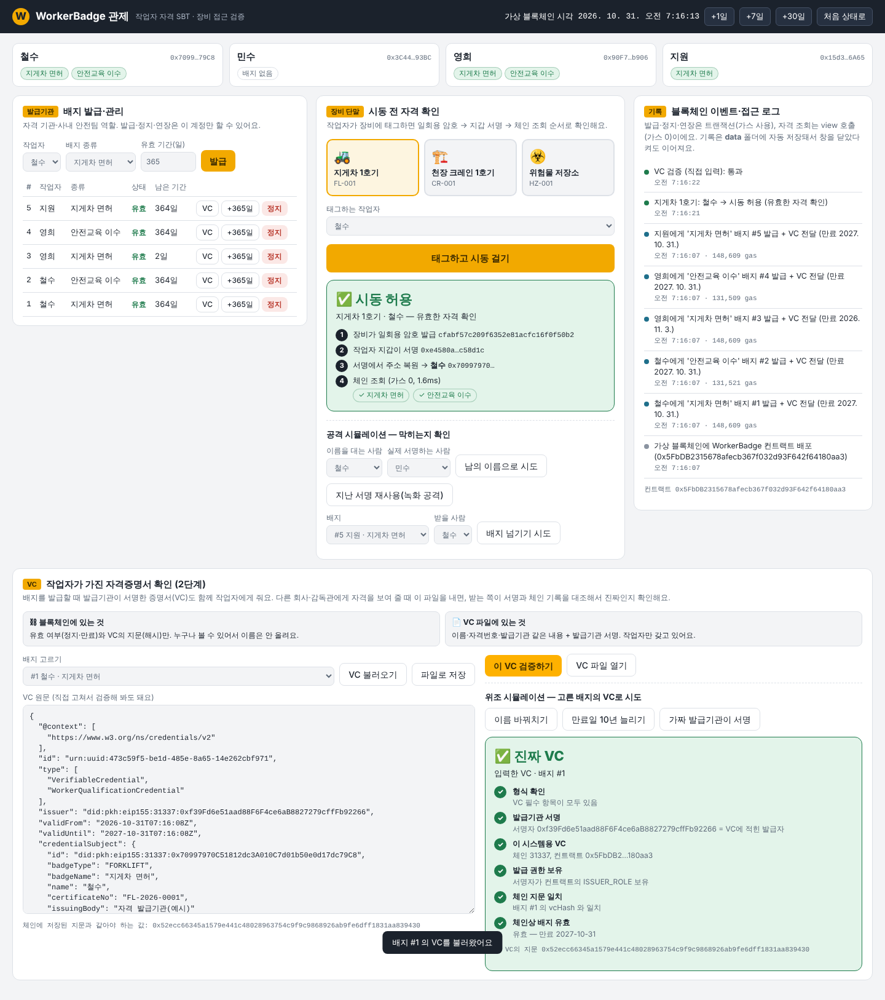

# WorkerBadge — 작업자 자격 SBT 배지 + VC + 장비 접근 검증 + AI 숙련도 감지 (3단계)

지게차·크레인 같은 특수 장비를 **유효한 자격이 있는 사람만** 조작하게 만드는 프로토타입입니다.

- 발급기관이 자격·안전교육 이수를 **양도 불가 배지(SBT)** 로 발급합니다.
- 장비는 시동 전에 **일회용 challenge + 작업자 서명**으로 본인을 확인하고, 체인에 **"이 사람 조작해도 돼?"** 를 물어봅니다.
- 발급할 때 발급기관이 서명한 **검증가능 자격증명(VC)** 도 함께 만듭니다. 이름·자격번호 같은 내용은 VC에만 있고, 체인에는 그 **지문(해시)** 만 올라갑니다. VC 원문은 **작업자 휴대폰에만 보관**하고(서버는 전달 후 삭제), 보여 줄 때는 휴대폰 서명을 붙인 **VP**로 제시합니다. (2단계)
- AI가 장비 센서 기록을 보고 숙련자와 크게 다르면 **재교육을 권고**하고, 발급기관이 확인 후 안전교육 배지를 정지 → 재교육 → 재발급합니다. (3단계, 결과: [docs/ai-results.md](docs/ai-results.md))

**팀원**: 정민우 · 김인서 · 심태규 · 박규성 (건양대학교 스마트보안학과)

## ⚡ 빠른 시작 (처음 받은 사람)

1. [Node.js LTS](https://nodejs.org) 를 설치해요 (20 이상).
2. 이 저장소를 받아요: 위의 초록색 **Code → Download ZIP** 후 압축 풀기, 또는 `git clone https://github.com/jminu48-star/dddd.git`
3. 폴더에서 실행해요.
   - Windows: `start.bat` 더블클릭
   - macOS: `start.command` (처음엔 터미널에서 `chmod +x start.command`)
   - 직접: `npm install` → `npm start` → 브라우저에서 http://localhost:3000
4. 휴대폰으로 해 보려면 `npm run phone` (start.bat 이 이걸 실행해요) — 인터넷 주소가 자동으로 만들어지고, 관리자 화면의 QR 을 휴대폰으로 찍으면 돼요.

- 블록체인은 **PC 안의 가상 블록체인(Hardhat)** 이라 지갑·이더·인터넷 없이 바로 돌아가요. Sepolia 테스트넷은 선택이에요 (`.env.example` → `.env`, 아래 "Sepolia" 참고).
- 테스트: `npm test` (자동 테스트 40개) · 시나리오 데모: `npm run demo` (10/10 PASS)
- AI 실험을 다시 돌리려면 Python 3 + `pip install -r ai/requirements.txt` → `python ai/train.py` / `python ai/phone_experiment.py`

## 🖥 프로그램으로 실행하기 (클릭해서 쓰는 화면)

**Windows**: 폴더 안의 `start.bat` 을 더블클릭하세요.
처음 한 번은 필요한 파일을 설치하느라 1~3분 걸리고, 그다음엔 브라우저에 **WorkerBadge 관제** 화면이 자동으로 열립니다.
(macOS 는 `start.command`, 직접 실행은 `npm start` 후 http://localhost:3000)

> Node.js(LTS)가 없으면 start.bat 이 설치 페이지를 열어 줍니다. 설치 후 다시 더블클릭하세요.



### 휴대폰 데이터(LTE·5G)로 접속 · 운용 기록 (팀원 factory-sbt 아이디어 반영)

- **인터넷 주소 자동 생성**: `start.bat` 이 무료 Cloudflare 터널로 `https://○○.trycloudflare.com` 주소를 만들어 QR 에 넣어요. 같은 와이파이가 필요 없어요. 못 만들면(학교·회사망) 같은 와이파이 모드로 켜져요. (`npm run phone`, 끄려면 `NO_TUNNEL=1`)
- **외부 접속 보호**: 인터넷·와이파이로 들어온 요청은 작업자 기능(QR 인증·내 배지·작업 종료)만 쓸 수 있어요. 발급·정지·리셋·AI 처리·관리자 화면은 **이 PC(localhost)에서만**.
- **휴대폰 연결 코드**: 휴대폰이 등록을 요청하려면 관리자 화면의 6자리 코드를 넣어야 해요 (한 번 쓰면 바뀜, 10분마다 바뀜). VC 는 그 휴대폰 공개 키로 암호화해서 보내므로 그 휴대폰만 열 수 있어요.
- **EIP-712 서명**: 장비 인증 서명이 "장비 / nonce / 만료 시각"을 항목별로 담고, 체인 ID·컨트랙트 주소에 묶여요 → 다른 체인·다른 배포본·유효 시간을 고친 서명은 안 통해요.
- **운용 세션**: 한 장비는 한 사람만 사용(다른 사람은 "사용 중 — 보류"). 휴대폰 **작업 종료** 또는 장비의 **작업자 이탈(좌석 센서 모사)** 로 끝나요. 끝나면 그 작업 기록을 **AI 가 자동 분석**해서 필요하면 재교육 권고를 올려요.
- **기록 파일**: `data/usage.csv` (누가·어떤 장비를·언제부터·얼마나·AI 결과), `data/access.csv` (모든 인증 시도·사유·체인 조회 ms) — 엑셀에서 바로 열려요.
- **거부 안내**: 휴대폰에 어떤 배지가 없는지, 관리자에게 무엇을 요청하면 되는지 보여 줘요.

### 본인 확인: 휴대폰 자기 지갑 + 얼굴 확인

"QR을 찍은 사람이 진짜 민우인가?"를 3겹으로 확인해요.

1. **휴대폰이 자기 지갑을 만듦** — 개인 키는 휴대폰 안에서 생성되고 밖으로 나가지 않아요. 서버는 주소와 서명만 받아요.
2. **서명으로 등록 요청 → 발급기관 승인** — 남의 주소로는 등록 요청을 못 보내요(서명 검증). 관리자가 신분증·자격증 원본을 보고 "기존 '민우'의 휴대폰으로 연결"을 누르면, 배지(SBT)는 양도가 안 되니 옛 주소 배지를 정지하고 휴대폰 주소로 **재발급**해요.
3. **얼굴 확인 (휴대폰 안에서만)** — 등록할 때 얼굴을 등록하고, 시동 서명 전마다 얼굴을 비교해요. 일치하지 않으면 **서명 자체를 하지 않아요**.
   - **살아 있는 사람 확인**: 고개를 살짝 돌리게 해요. 사진·화면은 평평해서 돌려도 "코가 두 눈 사이 어디쯤 있는지" 비율이 거의 안 바뀌어서 통과 못 해요.
   - **개인정보**: 얼굴은 개인정보보호법상 **민감정보**(생체인식정보)라서 사진은 저장하지 않고, 특징값(숫자 128개)만 **휴대폰 안에** 둬요. 서버·장비·블록체인에는 "일치/불일치"와 등록본 번호(faceId, 무작위 값)만 가요.
   - **얼굴 바꿔치기 방지**: 휴대폰을 빌린 사람이 얼굴 정보를 지우고 자기 얼굴로 다시 등록하면, faceId 가 바뀌어서 발급기관이 다시 승인하기 전까지 시동이 안 돼요 (관리자 화면에 "⚠ 얼굴을 새로 등록함" 경고).
   - 얼굴 인식: [@vladmandic/face-api](https://github.com/vladmandic/face-api) (MIT) — TinyFaceDetector + 68점 랜드마크 + 128차원 특징값, 같은 사람 기준 거리 0.5 미만.
   - 카메라는 **https 주소**(인터넷 모드, trycloudflare)에서만 열려요. 처음 한 번 모델 약 7MB 를 내려받아요.

테스트로 확인한 것: 본인 → 시동 허용 / 같은 사람 **사진** → 고개 돌림 확인 실패로 서명 안 함 / **다른 사람** → 거리 0.5 초과로 서명 안 함 / 얼굴 재등록 후 "얼굴 OK"라고 서버에 거짓 보고 → "승인한 얼굴 등록본이 아님"으로 거부 / 얼굴 결과 없이 서명만 → 거부.

**한계 (발표·논문에 쓸 점)**: 얼굴 판정은 휴대폰 브라우저가 하고 그 결과를 서버가 믿는 구조라, 앱을 고쳐 승인된 faceId 를 그대로 보내면 우회될 수 있어요. 실제 서비스라면 **WebAuthn 패스키**(아이폰 Face ID·안드로이드 지문으로 보안 칩 안의 키를 잠금)를 써서, 생체 확인 없이는 서명 키 자체를 못 쓰게 해야 해요. 정교한 3D 마스크·딥페이크 영상도 이 수준의 생존 확인으로는 못 막아요.

### 🧪 AI 실측 실험 — 휴대폰 센서로 검증

시뮬레이션 데이터만으로는 "실제로도 되느냐"를 증명할 수 없어서, 휴대폰 센서로 실제 기록을 모아 같은 방법을 검증해요.

- 휴대폰 작업자 앱 → **🧪 센서 실험** (`/sensor`). 휴대폰을 카트·RC카에 붙이고 20초씩 **부드럽게 / 거칠게** 움직여요. 가속도·회전 속도(약 60Hz)를 기록해서 PC의 `ai/phone_data/` 에 저장해요.
- 기록은 지갑으로 로그인한 휴대폰만 올릴 수 있어요. 잘못 기록하면 10분 안에 "방금 기록 빼기".
- 분석: `python ai/phone_experiment.py` → **참가자 단위 교차검증**(한 명을 통째로 빼고 나머지의 '부드럽게'만으로 학습 → 뺀 사람 판정) 결과가 `docs/phone-experiment.md` 에 나와요.
- 분석 뒤에는 새 기록을 올리자마자 휴대폰에 AI 판정(이상 점수·추천 교육)이 떠요 — 발표 때 그 자리에서 카트를 밀어 보여 줄 수 있어요.
- **실제 작업에 연결**: 시동을 걸면 휴대폰이 작업 중 센서를 기록하고, **작업 종료** 때 AI가 그 실제 기록으로 분석해요 (화면에 "📡 휴대폰 센서 N초 실측"). 센서 기록이 없거나 8초보다 짧으면 장비 화면에서 고른 시험용 기록으로 분석하고 그렇다고 알려 줘요.
- **판정 방법**: 실측 '부드럽게' 기록의 평균·표준편차 기준 z 점수. 실측 기록은 10개 안팎이라 Isolation Forest는 점수가 거칠어서(오판율 40%) 비교용으로만 써요 — 결과는 `docs/phone-experiment.md`.
- 휴대폰 방향에 상관없게 가속도·회전 속도의 **크기**만 써요. 속도·포크 높이는 휴대폰으로 못 재서 빠져요 (실제 장비는 차량 센서로 보완).

### 서버 없는 장비 단말 (Sepolia 직접 조회) — `terminal/`

같은 와이파이가 필요 없는 실제 운용 구조예요. 장비 화면이 Sepolia에 직접 묻고, 작업자는 휴대폰 **MetaMask 앱**으로 서명해요.
GitHub Pages에 올리는 법과 시연 순서: [terminal/README.md](terminal/README.md)

### 화면 3개 (실제 현장처럼 나눈 버전)

| 주소 | 누가 · 어디서 | 하는 일 |
|---|---|---|
| `http://localhost:3000/equipment` | **장비 단말** — 장비에 붙은 태블릿 역할 (PC 창) | 30초마다 바뀌는 QR 표시 → 인증되면 시동 허용/거부 |
| `http://<PC 주소>:3000/worker` | **작업자 앱** — 실제 휴대폰 | QR 찍기 → 내 지갑으로 서명, 내 배지·VC·AI 분석 보기 |
| `http://localhost:3000/admin` | **관리자(발급기관)** — PC | 발급·정지, AI 재교육 권고 확인, 장비별 인증 기록 |
| `http://localhost:3000/` | 시연용 통합 화면 | 모든 역할 + 공격·위조 시뮬레이션을 한곳에 |

- 시동 판단은 **장비가 체인을 조회해서 자동**으로 해요. 발급기관은 매번 끼지 않아요(서버가 꺼져도 검증 가능).
- QR은 30초마다 바뀌고 한 번 쓰면 바로 새것으로 바뀌어요. 사진으로 찍어 둔 QR로는 인증할 수 없어요.
- 휴대폰 연결: 휴대폰과 PC를 **같은 와이파이**에 연결하고, 관리자 화면의 "휴대폰으로 작업자 앱 열기" QR을 찍으세요. 처음 실행할 때 Windows 방화벽 창이 뜨면 **허용**을 누르세요.
- 학교 와이파이는 기기끼리 연결을 막는 경우가 많아요. 그럴 땐 **휴대폰 핫스팟에 PC를 연결**하면 돼요.
- 휴대폰이 없으면 장비 화면의 "이 PC에서 작업자 앱으로 열기" 링크로 같은 흐름을 시연할 수 있어요 (얼굴 확인에 PC 웹캠이 필요해요).
- 통합 화면의 작업자(규성·태규·인서)는 가상 블록체인의 **공개된 테스트 키**를 쓰는 연습용이에요. 휴대폰으로 등록·연결된 작업자(📱)는 개인 키가 휴대폰에만 있어서 통합 화면이 대신 서명할 수 없어요.

| 영역 | 할 수 있는 것 |
|---|---|
| 상단 | 가상 블록체인 시각 확인, **+1일 / +7일 / +30일** 시간 이동(만료 체험), 처음 상태로 |
| 작업자 카드 | 민우·규성·태규·인서이 가진 배지 (초록=유효, 빨강=정지, 회색 취소선=만료) |
| 발급기관 | 배지 발급, 정지, 365일 연장 — 실행할 때마다 사용한 가스가 기록에 남음 |
| 장비 단말 | 장비(지게차·크레인·위험물) + 작업자를 고르고 **태그하고 시동 걸기** → 일회용 암호·서명·주소 복원·필요 배지 확인 과정을 단계별로 보여 줌 |
| 공격 시뮬레이션 | 남의 이름으로 시도, 지난 서명 재사용, 배지 넘기기 — 모두 차단되는지 확인 |
| 기록 | 발급·정지·연장·접근 허용/거부·공격 시도가 시간순으로 쌓임 |
| AI (아래) | 작업자·운전 방식을 골라 작업 기록 분석 → 이상 점수·이유·추천 교육, 재교육 권고 목록에서 정지/오판 처리/재발급 |
| VC · VP (아래) | **VP 요청 QR** → 작업자 휴대폰이 VC를 골라 서명·제시 → 단계별 검증. VC 파일·VP 파일 열어 검증, 위조 시뮬레이션(이름 바꿔치기·만료일 늘리기·가짜 발급기관 서명) |

이 프로그램은 컴퓨터 안에 **가상 블록체인**을 띄워서 돌아갑니다. 진짜 돈이나 테스트넷은 쓰지 않습니다.

**기록 저장**: 발급·정지·연장·시간 이동과 화면 기록은 `data/` 폴더(`journal.json`, `events.json`)에 자동 저장됩니다. 창을 닫았다가 다시 켜면 같은 순서·같은 시각으로 다시 실행해서 그대로 복원하고, 닫아 둔 동안 흐른 실제 시간도 반영합니다(그 사이 만료된 배지는 만료로 보임). 완전히 처음부터 하려면 화면의 **처음 상태로** 버튼을 누르거나 `data` 폴더를 지우세요.

## 폴더 구성

| 파일 | 하는 일 |
|---|---|
| `contracts/WorkerBadge.sol` | 배지 컨트랙트 (발급·폐기·연장·양도 차단·장비별 자격 조회) |
| `scripts/vc.js` | VC 만들기(EIP-712 서명)·검증(서명→도메인→발급 권한→체인 지문→상태) |
| `ai/` | 3단계 AI: 센서 시뮬레이터, 특징, 학습(`train.py`), 프로그램용 모델(`model.json`) |
| `scripts/ai.js` | 학습된 모델을 JS로 계산 (프로그램은 Python 불필요) |
| `tasks/badge.js` | 테스트넷 명령: wallet, badge:deploy / issue / verify / status / revoke / renew / grant-issuer |
| `scripts/verifier.js` | 장비 단말(문지기) 역할 — challenge 발급, EIP-712 서명 검증, 체인 조회, 로그 |
| `scripts/phone.js` | 휴대폰 데이터용 인터넷 주소(Cloudflare 터널)를 만들고 프로그램 실행 (start.bat 이 사용) |
| `scripts/demo.js` | 시나리오 10개를 한 번에 돌리는 발표용 데모 |
| `scripts/deploy.js` | Sepolia 테스트넷 배포 |
| `test/WorkerBadge.test.js` | 컨트랙트·장비 검증 자동 테스트 15개 (EIP-712 위조 포함) |
| `test/VC.test.js` | VC 자동 테스트 9개 (위조·가짜 발급기관·정지·연장·재발급) |
| `test/AI.test.js` | AI 자동 테스트 5개 (Python 결과와 JS 결과 일치 등) |
| `test/VP.test.js` | VP 자동 테스트 6개 (VC 훔쳐 제시·holder 바꿔치기·질문 재사용·다른 검증자·내용 변조·정지 배지) |
| `test/PhoneAI.test.js` | 휴대폰 실측 실험 테스트 3개 (Python·JS 특징 계산 일치 등) |
| `docs/` | 데모·테스트 실행 결과, 화면 캡처, **Sepolia 따라 하기(`sepolia-guide.md`)** |
| `app/server.js` | 프로그램 서버 — 가상 블록체인 실행 + 화면에 데이터 제공 |
| `app/public/index.html` | 프로그램 화면 |
| `start.bat` / `start.command` | 더블클릭 실행 파일 |

## 실행 방법

필요한 것: Node.js 20 이상

```bash
npm install          # 처음 한 번
npm test             # 자동 테스트 40개
npm run demo         # 시나리오 데모 (로컬 가상 블록체인에서 실행)
```

`npm run demo` 결과 예시는 `docs/demo-output.txt` 에 있습니다. **10/10 PASS** 가 나오면 정상입니다.

## 컨트랙트 핵심 기능

| 함수 | 누가 | 하는 일 |
|---|---|---|
| `issue(작업자, 종류, 만료일, VC해시)` | 발급기관 | 배지 발급. 같은 종류의 유효한 배지가 있으면 거부 |
| `revoke(배지번호, 사유)` | 발급기관 | 배지 정지. 즉시 무효 |
| `renew(배지번호, 새 만료일)` | 발급기관 | 기한 연장 (폐기된 배지는 불가) |
| `setRequirement(장비종류, 필요배지[])` | 관리자 | 장비별 필요 자격 설정 |
| `isQualified(작업자, 장비종류)` | 누구나 (view, 가스비 0) | 필요한 배지가 전부 유효하면 true |
| `transferFrom` / `approve` | — | **항상 거부 (Soulbound)** |

배지 종류: `0 지게차 · 1 크레인 · 2 위험물 · 3 안전교육`
기본 규칙: 지게차 = 지게차 면허 + 안전교육, 크레인 = 크레인 면허 + 안전교육, 위험물 = 위험물 자격 + 안전교육

## 설계에서 지킨 것 (7주차 보안 체크리스트)

- **개인정보는 체인에 없음** — 이름·주민번호 대신 VC 해시만 저장 (블록체인은 private 도 누구나 읽음)
- **권한 검사 통일** — 발급·폐기·연장은 `ISSUER_ROLE`, 규칙 변경은 `DEFAULT_ADMIN_ROLE` (OpenZeppelin AccessControl)
- **주소 0·지난 만료일 거부**
- **재진입 지점 없음** — `_safeMint` 대신 `_mint` 를 써서 받는 쪽 코드를 호출하지 않음
- **상태 변경마다 이벤트** — 발급·폐기·연장·규칙 변경
- **custom error** — 문자열보다 가스가 쌈
- **block.timestamp 는 일 단위 만료 판단에만 사용** (초 단위 판단·난수에는 쓰지 않음)
- **무한 반복 없음** — `isQualified` 는 관리자가 정한 2~3개만 확인

## 데모 시나리오 (`npm run demo`)

1. 정상 작업자 → 허용
2. 무자격자 → 거부
3. 지게차 면허는 있으나 안전교육 미이수 → 거부
4. 만료 전 허용 → 4일 뒤 만료 후 거부
5. 녹화해 둔 서명 재사용 → 거부
6. 다른 사람이 자기 키로 서명 → 거부
7. 배지 폐기 후 → 거부
8. 배지를 다른 지갑으로 전송 시도 → 컨트랙트가 거절
9. 재교육 후 재발급 → 다시 허용

측정값(로컬): 발급 약 14.9만 gas, 폐기 약 3.5만 gas, 연장 약 3.4만 gas, 조회 0 gas

## VC 설계 (2단계)

| 구분 | 어디에 | 내용 |
|---|---|---|
| 배지 상태 | 블록체인 | 종류·만료일·정지 여부·**vcHash** — 누구나 읽으므로 개인정보 없음 |
| VC | **작업자 휴대폰** (브라우저 저장소) | 이름·자격번호·발급기관 + 발급기관 **EIP-712 서명** (W3C VC 2.0 형식, DID = `did:pkh:eip155:<체인ID>:<주소>`) |
| 서버 | `data/` | VC 원문 없음. 체인 지문과 같은 값만. 전달 전 잠깐 **암호문** 우편함(`vc-outbox.json`)에 있다가 휴대폰이 받으면 삭제 |
| 연결 | — | `vcHash = keccak256(VC 원문)` → VC를 한 글자만 바꿔도 체인과 불일치 |

검증 6단계: ① 형식 → ② 발급기관 서명 → ③ 이 체인·이 컨트랙트용인지 → ④ 서명자가 지금 `ISSUER_ROLE` 보유 → ⑤ 체인 vcHash 일치 → ⑥ 체인상 정지·만료 아님

- 정지·만료는 체인이 기준이에요. VC 파일은 스스로 무효가 될 수 없어서, 정지된 배지의 VC는 ⑥에서 걸려요.
- 연장하면 같은 VC로 다시 통과하고, 재발급하면 예전 VC는 ⑤에서 걸려요.
- VC ID가 무작위라서 체인의 해시만 보고 이름을 역추적할 수 없어요.

### 자기주권(SSI): VC는 작업자가 갖고, 보여 줄 땐 VP로

```
발급기관(서버)  VC 생성·서명 → 체인에 vcHash
               → 작업자 공개 키로 암호화 (ECDH secp256k1 + AES-256-GCM, 임시 키는 바로 버림)
               → 우편함(암호문)  ──휴대폰이 받아 감──▶  지문 확인 → 휴대폰에 저장 → "받았어요" → 서버 우편함에서 삭제
검증자(감독관)  VP 요청 QR (일회용 질문 challenge + 검증자 이름, 5분)
작업자 휴대폰   VC 고르기 → VP = VC + challenge + 검증자 이름 에 지갑 EIP-712 서명 → 제출
검증자          ① VP 형식 ② 제시자 서명 ③ 일회용 질문(안 쓰였고 5분 안) ④ 제시자 = VC 주인 ⑤ 안의 VC 6단계씩
```

- **공개 키**: 등록 서명에서 복원해요(공개 키라 알려져도 괜찮음). 예전 등록이면 휴대폰이 다음 접속 때 알려 주고, 서버는 그 키가 지갑 주소와 맞는지 확인해요.
- **막는 공격** (`test/VP.test.js`, E2E 확인): VC 파일만 훔쳐 자기 키로 VP 만들기 → ④ 거부 / holder 를 바꿔 적기 → ② 거부 / 가로챈 VP 다시 내기 → ③ "이미 쓴 질문" / 다른 검증자에게 낸 VP → ③ 거부 / VP 안 VC 고치기 → ②·⑤ 거부 / 정지된 배지 → ⑤ 거부.
- **분실 대비**: 휴대폰 VC 카드의 *VC 백업 파일 저장 / 가져오기* (가져올 때 체인 지문과 맞는 내 VC만 받아요). 서버에는 사본이 없어서 서버가 대신 돌려줄 수 없어요 — 대신 발급기관이 재발급할 수 있어요.
- **예전 기록 정리**: 예전 버전 기록(`data/journal.json`)에 휴대폰 작업자 VC 원문이 있으면, 켤 때 지문만 남기고 우편함으로 옮겨요.
- **검증자 사본**: 관리자 화면이 VP로 받은 VC는 메모리에만 두고 30분 뒤 지워요 (위조 시뮬레이션용).
- **시연용 예외**: 통합 화면의 테스트 계정 작업자(휴대폰 없음)는 서버가 대신 보관해요 — 관리자 화면에 "시연용 · 서버 보관"으로 표시.
- **다음 과제**: 필요한 항목만 보여 주는 선택적 공개(SD-JWT·BBS+), 휴대폰 보안 저장소(키체인·하드웨어 키) 사용.

## Sepolia 테스트넷에 올리기 (2단계)

처음이면 **[docs/sepolia-guide.md](docs/sepolia-guide.md)** 를 따라 하세요. MetaMask 테스트 지갑 만들기, 테스트 ETH 받기, `.env` 설정이 들어 있어요.

```bash
npm run sepolia:wallet                                   # 주소·잔액 확인
npm run sepolia:deploy                                   # 배포 → deployments/sepolia.json
npm run sepolia:issue -- --worker 0x작업자 --type 0 --name "홍길동"   # 발급 + vcs/sepolia-1.json
npm run sepolia:verify -- --file vcs/sepolia-1.json      # VC 6단계 검증
npm run sepolia:status -- --worker 0x작업자              # 장비별 조작 가능 여부
```

> 개인키는 절대 코드나 git에 올리지 마세요. `.env`와 `vcs/`는 `.gitignore`에 들어 있습니다. 폴더를 zip으로 보낼 때는 `.env`를 직접 빼세요.

## Remix 에서 바로 돌려 보기

`contracts/WorkerBadge.sol` 내용을 Remix 에 붙여 넣으면 OpenZeppelin import 를 Remix 가 알아서 받아 옵니다. 컴파일러 0.8.24 로 컴파일 → `admin` 칸에 내 주소를 넣고 Deploy.

## 아직 안 한 것 (다음 단계)

- Sepolia 실제 배포 결과(주소·tx·가스) 기록 — 지갑 준비 후 `docs/sepolia-guide.md`
- 얼굴 확인을 WebAuthn 패스키(Face ID·보안 칩)로 바꾸기
- Arduino + NFC/QR 장비 단말
- 실제 장비 센서 데이터로 AI 재학습 (지금은 시뮬레이션 데이터)
- React 관리자 화면

## 참고: 이 저장소의 실습 환경 메모

`hardhat.config.js` 아래쪽의 `USE_LOCAL_SOLC` 블록은 컴파일러 다운로드가 막힌 환경용입니다. 일반 PC 에서는 신경 쓰지 않아도 됩니다.
