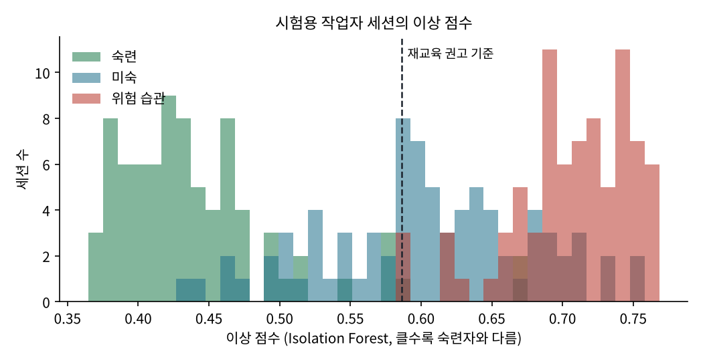
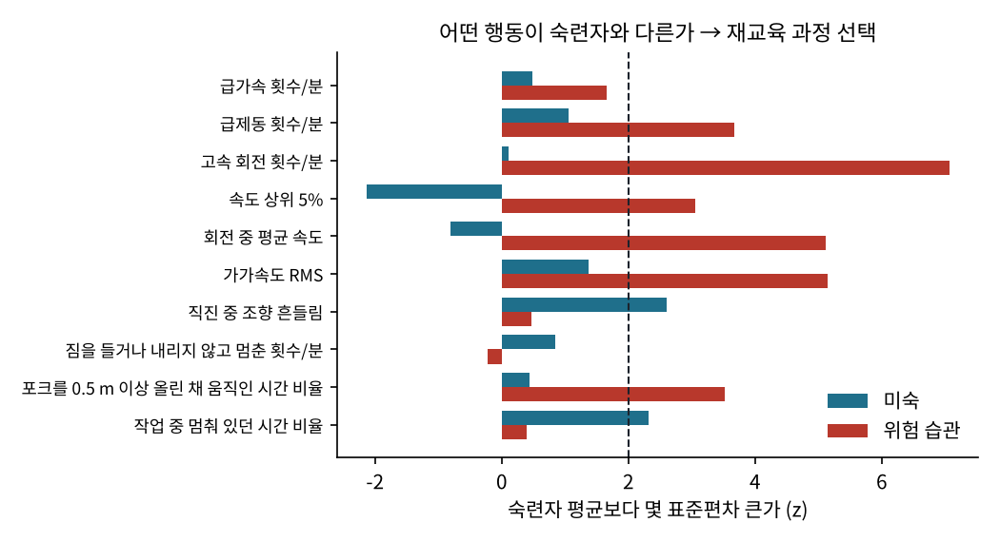

# 3단계 AI 실험 결과 — 지게차 조작 숙련도 감지

> **시뮬레이션 데이터로 얻은 결과입니다.** 실제 장비 센서 데이터가 없어서 `ai/simulate.py` 로 만든 데이터를 썼어요.
> 숫자는 "이 방법이 동작하는지"를 보여 주는 값이고, 실제 현장 성능은 실제 데이터로 다시 재야 해요.

다시 만들기: `pip install -r ai/requirements.txt` → `python ai/train.py` (seed 2026 고정, 같은 숫자가 나와요)

## 데이터

| 항목 | 값 |
|---|---|
| 작업자 | 120명 (숙련 40 · 미숙 40 · 위험 습관 40) |
| 세션 | 1,200개 (작업자당 10개 × 3분, 10Hz) |
| 센서 채널 | 속도, 전후 가속도, 좌우 가속도, 회전 각속도, 포크 높이 |
| 나누기 | **작업자 단위**로 학습 720 / 검증 240 / 시험 240 세션 (같은 사람이 학습과 시험에 함께 들어가지 않게) |
| 특징 10개 | 급가속·급제동·고속 회전 횟수/분, 속도 상위 5%, 회전 중 속도, 가가속도 RMS, 직진 중 조향 흔들림, 머뭇거림 정지, 포크를 올린 채 주행 비율, 정지 시간 비율 |

## 결과 1 — 재교육 권고 (Isolation Forest, 숙련자 데이터만으로 학습)

판단 기준 0.586 = 검증용 숙련자 세션의 95번째 백분위(숙련자를 잘못 잡는 비율 약 5% 목표)

| 판단 단위 | 정밀도 | 재현율 | F1 | AUC | 숙련자 오판율 |
|---|---|---|---|---|---|
| 세션 1개 | 0.985 | 0.831 | 0.902 | 0.971 | 2.5% |
| 최근 3세션 평균 | 0.991 | 0.852 | 0.916 | 0.995 | 1.6% |

- 위험 습관은 98.8%를 잡았고, 미숙은 67.5%를 잡았어요. 미숙자는 속도가 느려서 위험 신호가 약하게 나와요.
- 3세션 평균으로 판단하면 오판이 줄어요. 한 번의 실수로 바로 권고되지 않게 할 수 있다는 근거예요.

## 결과 2 — 유형 분류 (랜덤 포레스트, 라벨 사용, 비교용)

macro F1 **0.913**, 정확도 0.912

| 실제 \ 예측 | 숙련 | 미숙 | 위험 습관 |
|---|---|---|---|
| 숙련 | 73 | 7 | 0 |
| 미숙 | 12 | 68 | 0 |
| 위험 습관 | 2 | 0 | 78 |

이진(재교육 필요 여부)으로 보면 F1 0.933이지만 숙련자 오판율이 8.7%로, Isolation Forest(2.5%)보다 높아요.
게다가 라벨(누가 미숙한지)이 있어야 학습할 수 있어서, 현장에서는 Isolation Forest를 주 판단으로 쓰고 분류기는 유형 참고용으로만 써요.

## 결과 3 — 재교육 과정 추천 (숙련자 평균 대비 z ≥ 2인 행동)

| 실제 스타일 | 가장 많이 추천된 과정 (권고된 세션 수) |
|---|---|
| 위험 습관 | 회전 구간 감속·전도 방지 (51), 부드러운 가감속 운전 (20), 적재물 높이·운반 자세 (7) |
| 미숙 | 기본 조작 실습 — 조향·발진 (41), 부드러운 가감속 운전 (9) |

## 블록체인과 연결 (체험 프로그램)

1. AI가 기준을 넘으면 **재교육 권고**를 내요. 원본 센서 데이터와 판단 기록은 체인에 올리지 않아요.
2. **발급기관이 확인**하고 정지 여부를 결정해요. 오판이면 "오판으로 처리"를 눌러 배지를 그대로 둬요.
3. 정지하는 것은 **사내 안전교육 배지**예요. 국가 면허는 회사가 정지할 수 없기 때문이에요. 안전교육 배지가 없으면 모든 장비 시동이 막혀요.
4. 재교육을 이수하면 안전교육 배지를 **재발급**하고, VC에 이수한 과정(`retrainingCourses`)을 기록해요.

## 한계

- 시뮬레이션 데이터는 우리가 정한 규칙으로 만들었기 때문에, 모델이 그 규칙을 다시 배우는 면이 있어요. 실제 데이터로 검증해야 해요.
- 미숙자 재현율(67.5%)이 낮아요. 작업 시간·작업량 같은 특징을 추가하면 개선될 수 있어요.
- 프로그램은 Python으로 학습한 모델을 JS로 그대로 계산해요. 자동 테스트로 두 결과가 1e-6 안에서 같은지 확인하고 있어요.
