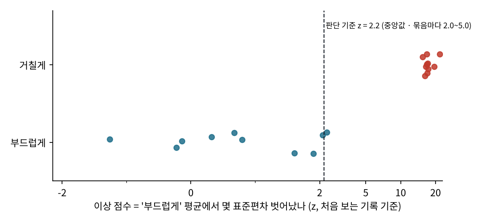
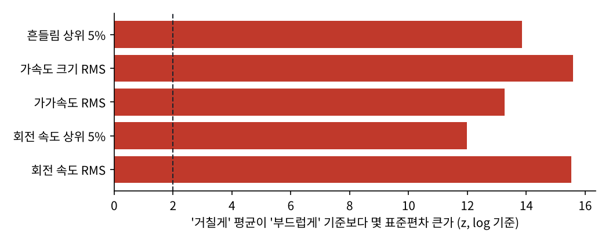

# 휴대폰 센서 실측 실험 — 실제 센서로도 AI가 거친 운전을 잡는가

> **실제 휴대폰 센서로 기록한 데이터**로 만든 결과예요 (시뮬레이션 아님). 분석: 2026-11-03 10:22
> 다시 만들기: `python ai/phone_experiment.py`

> ⚠ **참가자가 1명**이라 "처음 보는 사람에게도 통하는가"는 아직 증명하지 못했어요. 팀원 기록을 더하면 같은 명령으로 사람 단위 검증이 돼요.

## 실험 방법

- 휴대폰을 카트·RC카에 고정하고 같은 코스를 20초씩 움직였어요. **부드럽게** = 천천히 출발·정지·회전, **거칠게** = 급출발·급정지·급회전.
- 휴대폰 가속도(중력 제외)와 회전 속도를 약 60Hz로 기록하고, 방향에 상관없게 **크기**만 써서 특징을 뽑았어요.
- **판정**: '부드럽게' 기록의 평균·표준편차를 기준으로, 새 기록이 몇 표준편차(z) 벗어났는지 봐요. 가속도·회전 속도 특징 5개를 log로 바꾼 뒤 z의 **최댓값**이 이상 점수예요.
- **평가**: 기록 5묶음 교차검증 (참가자 1명 — 사람 단위 검증은 아직 못 함). 뺀 쪽은 학습에 안 쓰고, 기준선은 '부드럽게' 기록을 처음 보는 기록처럼 매긴 점수의 95번째 백분위예요.
- 기록 20개 (부드럽게 10 · 거칠게 10) · 참가자 1명 (민우)

## 결과 — 처음 보는 기록으로 판정

| 방법 | 재현율 (거칠게를 잡음) | 오판율 (부드럽게를 거칠게로) | 정밀도 | F1 | AUC |
|---|---|---|---|---|---|
| **숙련 기준 z 점수 (채택)** | **1.0** (95% 구간 0.722~1) | **0.0** (95% 구간 0~0.278) | 1.0 | 1.0 | 1.0 |
| Isolation Forest (비교) | 1.0 | 0.4 | 0.714 | 0.833 | 0.91 |

점수 범위: 부드럽게 최대 z = 2.3 · 거칠게 최소 z = 15.46

| 뺀 쪽 | 기록 수 | 기준 z | 재현율 | 오판율 |
|---|---|---|---|---|
| 묶음1 | 4 | 2.052 | 1.0 | 0.0 |
| 묶음2 | 4 | 3.578 | 1.0 | 0.0 |
| 묶음3 | 4 | 2.179 | 1.0 | 0.0 |
| 묶음4 | 4 | 5.019 | 1.0 | 0.0 |
| 묶음5 | 4 | 1.967 | 1.0 | 0.0 |

**왜 Isolation Forest가 아니라 z 점수인가**: 시뮬레이션에서는 학습 기록이 수백 개라 Isolation Forest가 잘 동작했지만, 실측은 '부드럽게' 기록이 10개 안팎이에요. 나무 깊이가 3단계 정도밖에 안 돼서 점수가 거칠고, 처음 보는 '부드럽게' 기록도 쉽게 튀어 보여요(오판율 0.4). 기록이 적을 때는 평균·표준편차 기준이 더 안정적이에요.

**판정에서 뺀 특징**: '급가속·급제동 횟수', '급회전 횟수'는 계속 세게 흔들리면 문턱을 넘은 채 유지돼서 한 번으로 세어져요. 실제로 '거칠게'가 '부드럽게'보다 횟수가 적게 나와서 판정에서 뺐어요 (화면에는 참고로 보여 줌).

## 어떤 행동이 달랐나 (거칠게 평균의 z)

| 특징 | z |
|---|---|
| 가속도 크기 RMS (m/s²) | 15.6 |
| 회전 속도 RMS (rad/s) | 15.5 |
| 흔들림 상위 5% (가속도 크기, m/s²) | 13.8 |
| 가가속도 RMS (m/s³) — 조작이 거친 정도 | 13.3 |
| 회전 속도 상위 5% (rad/s) | 12.0 |

## 한계

- '거칠게'는 참가자가 **일부러 연기한** 운전이고, 이번 기록은 차이가 매우 커요(가속도 상위 5%가 2~5g). 실제 미숙 운전은 이보다 훨씬 덜 거칠어서 더 어려워요 → 다음엔 '조금 서툴게' 기록도 모아야 해요.
- 카트·RC카는 지게차가 아니에요. 속도·포크 높이는 휴대폰으로 잴 수 없어서 뺐어요 — 실제 장비에서는 차량 센서(CAN·텔레매틱스)로 보완해야 해요.
- 기록 수가 적어서 위 95% 구간이 넓어요. 수치보다 "실제 센서에서도 같은 흐름(기록 → 판정 → 재교육 권고)이 동작한다"는 근거로 써야 해요.
